> ## ⚠️ HISTORICAL DOCUMENT — describes the pre-migration system
>
> This review documents the architecture **as it was before the Postgres/Flyway
> migration**, and is kept only as a record of that design. It is not a
> description of the code in this repository today. Do not use it to onboard.
>
> | This document says | The code actually does now |
> |---|---|
> | Spring Boot 2.7, MySQL | Spring Boot 3.5.6, Supabase Postgres |
> | Hibernate `ddl-auto=update` owns the schema | Flyway owns it; `ddl-auto=validate` |
> | "no test suite" | 240 JUnit tests |
> | "no containerization" | `Dockerfile` + `docker-compose.yml` |
> | Retrieval is "a naive keyword scan" | pgvector + bge-m3 hybrid retrieval |
> | Single Maven module | `siddhamind-core` + `siddhamind-ai` + `react-app` |
>
> Current documentation: [README.md](README.md),
> [docs/SUPABASE_SETUP.md](docs/SUPABASE_SETUP.md),
> [docs/INGESTION.md](docs/INGESTION.md), [docs/RETRIEVAL.md](docs/RETRIEVAL.md).
>
> The matching pre-migration source tree (`siddhamind-core/legacy-reference/`)
> was deleted in the 2026-09-23 cleanup; this file is what remains of that era.

# SiddhaMind AI — Full Architecture Review & Engineering Documentation

**Repository:** `siddhamind/` (single Maven module, `com.siddhamind`)
**Prepared for:** engineers onboarding to, maintaining, or extending the codebase
**Method:** every non-generated file was read and cross-referenced (`src/main/java`, `src/main/resources`, `pom.xml`, `README.md`, `.vscode`, `.gitignore`). `target/` was excluded as a build artifact.

> **Read this first.** The README describes an ambitious target design (Gemini embeddings, cosine-similarity vector search, Tesseract OCR fallback, a documented `db/schema-reference.sql`, `static/css/siddha.css`, `static/js/app.js`). The actual code implements a **subset** of that design. Every place where the running code diverges from the README's description is called out explicitly in this document — this is the single most important thing for a new engineer to understand before touching the RAG or corpus-indexing code.

---

## 1. Executive Summary

SiddhaMind AI is a **server-rendered Java monolith** (Spring Boot 2.7 + Thymeleaf + MySQL) that digitises a Siddha-medicine knowledge base into four role-gated modules: a citation-constrained Q&A assistant, a deterministic drug-safety checker, a classical eight-fold diagnosis tool (Envagai Thervu), and an admin console for corpus/user management. It is a college/demo-grade academic project (BSMS coursework, per `data.sql` seed data), not a production system — there is no test suite, no CI/CD, no containerization, and authentication is a hand-rolled session mechanism rather than Spring Security.

The architecture is intentionally simple: one Spring MVC application, one MySQL schema managed by Hibernate `ddl-auto=update`, one servlet `HandlerInterceptor` doing all access control, and one outbound integration (Google Gemini's `generateContent` REST endpoint, called with raw `java.net.http.HttpClient` and hand-written JSON string concatenation — no SDK, no Jackson object mapping for the request).

The most consequential design decision, and the one most worth preserving if this is extended, is in `SafetyService`: **the AI never decides the safety verdict.** A deterministic rule engine computes risk level from database facts (heavy-metal thresholds, ingredient×drug interaction rows, contraindication rows); Gemini is only asked to phrase an explanation of a verdict that has already been computed. The same pattern is intended for the RAG assistant (answer only from retrieved passages) but the retrieval side is currently a naive keyword scan, not the embedding-based pipeline the README describes — see §7.3 and §16.

## 2. Repository Overview

| Path | Contents | Purpose |
|---|---|---|
| `pom.xml` | Maven build, Spring Boot 2.7.18 parent, WAR packaging | Build definition, dependency versions |
| `README.md` | Project pitch, setup instructions, target design | Onboarding doc — **partially aspirational**, see discrepancies below |
| `src/main/java/com/siddhamind/` | All application code (85 files total in repo, ~60 Java files) | Application logic |
| `src/main/resources/application.properties` | All runtime configuration (DB, Gemini, RAG tuning, OCR, upload) | Single config source, no profiles |
| `src/main/resources/data.sql` | Seed data: 4 roles, 4 demo users, 6 source docs, 20 ingredients, 10 formulations, 13 diseases, 12 drugs, 18 interactions, 12 contraindications, 3 notifications | Bootstraps a usable demo on first run |
| `src/main/resources/templates/` | 23 Thymeleaf `.html` views | Server-rendered UI |
| `src/main/resources/static/` | `static/js/` directory exists but is **empty** | See §16 — referenced but missing assets |
| `corpus/`, `uploads/` | Empty except `.gitkeep`; git-ignored | Runtime storage for uploaded PDFs and file uploads (`app.corpus.dir`, `app.upload.dir`) |
| `.vscode/settings.json` | Editor config only | Not part of the runtime |
| `target/` | Maven build output | **Excluded from analysis** — generated artifact |

There is no `db/schema-reference.sql` in the repository despite the README referencing it twice — Hibernate's `ddl-auto=update` is the only schema source that actually exists.

### 2.1 Clean repository tree

```
siddhamind/
├── pom.xml
├── README.md
├── .gitignore
├── .vscode/settings.json
├── corpus/                                # empty, git-ignored — PDF corpus lands here at runtime
├── uploads/                                # empty, git-ignored — general file uploads
└── src/main/
    ├── java/com/siddhamind/
    │   ├── SiddhaMindApplication.java      # @SpringBootApplication entry point (also WAR-deployable)
    │   ├── config/
    │   │   ├── AuthInterceptor.java        # hand-rolled session RBAC (the only "security" layer)
    │   │   └── WebConfig.java              # registers the interceptor on all routes
    │   ├── controller/                     # 7 @Controller classes (README says 8 — see §16 discrepancies)
    │   │   ├── AdminController.java        # /admin/** — users, corpus upload+index, reports
    │   │   ├── AssistantController.java    # /assistant/** — chat/RAG
    │   │   ├── AuthController.java         # /, /login, /register, /logout, /denied
    │   │   ├── DashboardController.java    # per-role dashboards + /profile
    │   │   ├── DiagnosisController.java    # /diagnosis/** — Envagai Thervu
    │   │   ├── FormularyController.java    # /formulary/** — read-only knowledge browser
    │   │   └── SafetyController.java       # /safety/** — drug-safety checker
    │   ├── dto/                            # view/response-shaping objects, not persisted
    │   │   ├── Citation.java, DiagnosisResult.java, Finding.java, RagAnswer.java, SafetyReport.java
    │   ├── entity/                         # 18 @Entity classes, one per DB table (see §9)
    │   ├── repository/                     # 18 Spring Data JpaRepository interfaces, one per entity
    │   ├── service/                        # business logic layer
    │   │   ├── AuthService.java            # authenticate/register, SHA-256 password check
    │   │   ├── DiagnosisService.java       # Envagai Thervu scoring engine + AI summary
    │   │   ├── GeminiService.java          # raw HTTP client for Gemini generateContent
    │   │   └── SafetyService.java          # deterministic safety rule engine + AI explanation
    │   └── util/
    │       ├── HashUtil.java               # SHA-256 password hashing (no salt)
    │       └── TextUtil.java               # fixed-size sliding-window text chunker
    └── resources/
        ├── application.properties          # all config, including several unused keys (§16)
        ├── data.sql                        # seed data, loaded on every start (spring.sql.init.mode=always, INSERT IGNORE)
        ├── static/js/                      # empty directory — referenced JS/CSS files do not exist
        └── templates/
            ├── fragments/layout.html       # head/navbar/sidebar/footer/scripts fragments, reused by every page
            ├── index.html, login.html, register.html, denied.html, profile.html
            ├── dashboard/{admin,practitioner,student,patient}.html
            ├── assistant/chat.html
            ├── diagnosis/{form,result,history}.html
            ├── formulary/{list,detail,ingredients,diseases,disease}.html
            ├── safety/check.html
            └── admin/{users,corpus,reports}.html
```

## 3. Technology Stack

| Technology | Version | Purpose | Where used | Key dependencies |
|---|---|---|---|---|
| Java | 11 (target/source in `pom.xml`; README also mentions 17 as an option) | Language runtime | Entire `src/main/java` | — |
| Spring Boot | 2.7.18 (parent POM) | Application framework, embedded Tomcat, auto-configuration | `SiddhaMindApplication.java` | spring-boot-starter-web, -thymeleaf, -data-jpa, -validation, -tomcat |
| Spring MVC | (bundled in spring-boot-starter-web) | HTTP routing, `@Controller` dispatch, `HandlerInterceptor` | `controller/*`, `config/*` | — |
| Spring Data JPA / Hibernate | (bundled) | ORM, repository pattern, schema generation | `repository/*`, `entity/*` | `spring.jpa.hibernate.ddl-auto=update` |
| Thymeleaf | (bundled) | Server-side HTML templating | `templates/**` | `spring-boot-starter-thymeleaf` |
| MySQL | 8.x (driver 8.0.33) | Relational datastore, 18 tables | `application.properties` datasource | `mysql-connector-java` |
| Apache PDFBox | 2.0.30 | PDF text extraction during corpus indexing | `AdminController.indexDoc()` | `org.apache.pdfbox:pdfbox` |
| Tess4J (Tesseract binding) | 5.9.0 | **Declared as a Maven dependency but never called from any Java class** | `pom.xml` only | See §16 — dead dependency |
| Jackson (`jackson-databind`) | (Spring Boot managed) | Declared for Gemini JSON handling | `pom.xml` only | **Not actually used** — `GeminiService` builds/parses JSON with manual string concatenation and `indexOf`/`substring`, not Jackson |
| Google Gemini API | `gemini-2.0-flash` (chat), `text-embedding-004` (declared, unused) | Generative text completion | `GeminiService.generate()` | Called via `java.net.http.HttpClient`, REST endpoint `generateContent` |
| Bean Validation | (spring-boot-starter-validation) | Declared, but no `@Valid`/`@NotNull` annotations found on any controller parameter or entity | `pom.xml` only | Effectively unused |
| Bootstrap | 5.3.3 (CDN) | CSS framework / UI components | `fragments/layout.html` `<head>` | Loaded from `cdn.jsdelivr.net`, not bundled |
| Bootstrap Icons | 1.11.3 (CDN) | Icon font | `fragments/layout.html` | CDN |
| Noto Sans Tamil | (Google Fonts CDN) | Tamil-script typography | `fragments/layout.html` | CDN |
| Auth/session | Custom, no library | Login state via `HttpSession` attributes (`userId`, `currentUser`, `role`) | `AuthController`, `AuthInterceptor` | No Spring Security, no JWT, no OAuth |
| Password hashing | SHA-256, unsalted | Stored in `users.password_hash` | `HashUtil.sha256()` | `java.security.MessageDigest` — see §16 for the security implication |
| Build tool | Maven 3.8+ | Dependency management, packaging | `pom.xml` | Packaging = `war`, also runnable via `spring-boot-maven-plugin` |
| Deployment target | Embedded Tomcat (`mvn spring-boot:run`) or external Tomcat 9 (WAR) | `SiddhaMindApplication extends SpringBootServletInitializer` supports both | `pom.xml`, `SiddhaMindApplication.java` | `spring-boot-starter-tomcat` scope=`provided` for the WAR path |
| Testing | **None found** | `spring-boot-starter-test` is a declared dependency, but there is no `src/test` directory in this repository | `pom.xml` only | Dead dependency in this checkout |
| CI/CD, Docker | **None found** | No `Dockerfile`, no `.github/workflows`, no `Jenkinsfile`, no YAML pipeline of any kind | — | Deployment is manual (`mvn clean package` → copy WAR) |
| Logging | `java.util.logging`/SLF4J via Spring Boot defaults + raw `System.out.println` in `GeminiService.init()` and `e.printStackTrace()` in `GeminiService.generate()` | Startup diagnostics, error visibility | `application.properties` (`logging.level.com.siddhamind=INFO`), `GeminiService.java` | No structured logging, no log aggregation |
| Monitoring/APM | **None found** | No Actuator dependency, no metrics exporter | — | — |

## 4. High-Level Architecture

**Architectural style:** a classic **layered monolith** (Controller → Service → Repository → Entity/Database), server-rendered with Thymeleaf. It is *not* a REST API + SPA — there is no JSON API surface for the browser, no `@RestController`, no client-side framework, and grep across all 23 templates confirms zero `fetch`/`XMLHttpRequest`/`axios` calls. Every user action is a classic HTML form POST or link GET, and the server returns a full HTML page each time (see §12, Phase 11).

It is also not Clean/Hexagonal/DDD in any formal sense — there are no ports/adapters, no domain aggregates, no use-case objects; controllers talk directly to repositories in several places (`AdminController`, `DashboardController`, `FormularyController` inject repositories directly rather than going through a service), while `SafetyService`, `DiagnosisService`, and `AuthService` do hold real business logic. This is a pragmatic, not strictly layered, monolith — some controllers are thin, some are not.

- **Frontend:** Thymeleaf templates rendered server-side, styled with Bootstrap 5 (CDN) + a `siddha.css` and `app.js` that are referenced in `fragments/layout.html` but do not exist in the repository (broken links at runtime — see §16).
- **Backend:** Spring MVC controllers → services → Spring Data repositories → Hibernate → MySQL.
- **Database:** single MySQL 8 schema (`siddha`), 18 tables, auto-created/updated by Hibernate (`ddl-auto=update`) and seeded by `data.sql` on every boot.
- **External services:** exactly one — the Google Gemini REST API (`generativelanguage.googleapis.com`), called from `GeminiService`. No other third-party APIs, queues, caches, or object storage are used. File storage (PDF corpus, uploads) is the local filesystem (`app.corpus.dir=./corpus`, `app.upload.dir=./uploads`).
- **Internal services:** none — this is a single deployable unit, not microservices.

### 4.1 System architecture diagram

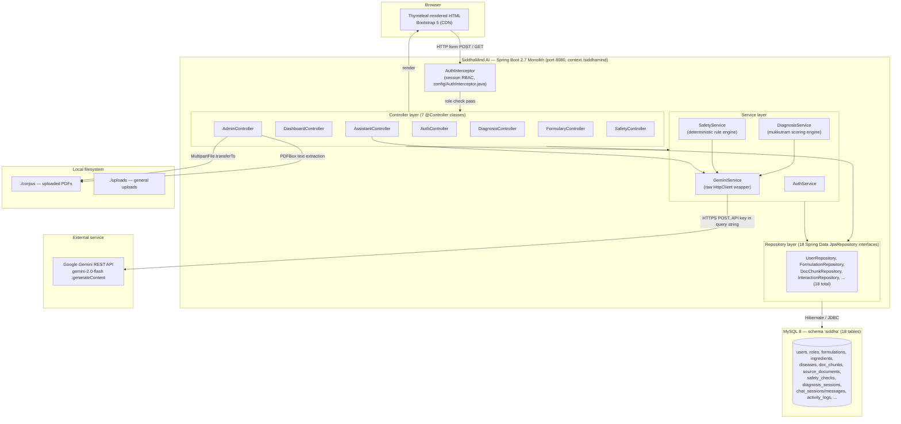

### 4.2 Layer communication summary

| From | To | Mechanism |
|---|---|---|
| Browser | Controller | HTTP GET/POST, form-encoded params, session cookie (`JSESSIONID`) |
| `AuthInterceptor` | Controller | `preHandle` gate — redirects to `/login` or `/denied` before the controller method runs |
| Controller | Service | Direct Java method call (constructor-injected, no interfaces beyond the service class itself) |
| Controller | Repository | Direct Java method call — several controllers bypass the service layer entirely |
| Service | Repository | Direct Java method call |
| Repository | MySQL | Hibernate-generated SQL over JDBC (`mysql-connector-java`) |
| Service (`GeminiService`) | Gemini API | Synchronous HTTPS POST, blocking `HttpClient.send()`, on the request-handling thread |
| Controller | Thymeleaf view | `Model` attributes + returned view name string, resolved by Spring's `ViewResolver` |

## 5. Application Startup

**Entry point:** `src/main/java/com/siddhamind/SiddhaMindApplication.java`

```java
@SpringBootApplication
public class SiddhaMindApplication extends SpringBootServletInitializer {
    public static void main(String[] args) { SpringApplication.run(SiddhaMindApplication.class, args); }
    @Override
    protected SpringApplicationBuilder configure(SpringApplicationBuilder builder) {
        return builder.sources(SiddhaMindApplication.class);
    }
}
```

Extending `SpringBootServletInitializer` is what allows the same class to boot two ways: `mvn spring-boot:run` (embedded Tomcat, `main()` path) or deployment as `siddhamind.war` on an external Tomcat 9 (`configure()` path, servlet container calls it).

### 5.1 Startup sequence (step by step)

1. **JVM launch** — `main()` invokes `SpringApplication.run()`.
2. **Configuration loading** — Spring Boot loads `src/main/resources/application.properties` (the only config file; no `application-{profile}.properties`, no profiles are used anywhere in the codebase).
3. **Environment resolution** — `app.gemini.api-key=${GEMINI_API_KEY:PUT_YOUR_GEMINI_API_KEY_HERE}` resolves the `GEMINI_API_KEY` OS environment variable if present, else falls back to the placeholder string.
4. **Auto-configuration** — Spring Boot auto-configures the embedded Tomcat (port `8080`, context path `/siddhamind` per `server.servlet.context-path`), the `DataSource` (MySQL, `createDatabaseIfNotExist=true` — the `siddha` schema itself is created automatically if missing), the JPA `EntityManagerFactory`, and Thymeleaf's `ViewResolver`.
5. **Component scanning / dependency injection** — Spring scans `com.siddhamind` and below, discovering `@Controller`, `@Service`, `@Component`, `@Configuration`, and `@Repository`(-equivalent `JpaRepository`) beans. All wiring in this codebase is **constructor injection** — no `@Autowired` field injection anywhere.
6. **Schema initialization** — Hibernate's `ddl-auto=update` inspects the 18 `@Entity` classes and creates/alters matching tables in the `siddha` schema. This happens before data seeding because `spring.jpa.defer-datasource-initialization=true` defers `data.sql` until after Hibernate has finished.
7. **Data seeding** — `spring.sql.init.mode=always` + `data-locations=classpath:data.sql` runs the seed script **on every application start**, not just the first. Every statement uses `INSERT IGNORE`, so re-running is idempotent (skips rows whose primary key already exists) and `spring.sql.init.continue-on-error=true` means a partial/schema-mismatch failure won't crash boot.
8. **Bean post-construction** — `GeminiService.init()` (`@PostConstruct`) runs, checking whether `app.gemini.api-key` is set and not the placeholder; it sets an internal `ready` flag and logs one of two lines to stdout: `"Gemini API connected"` or `"Gemini API not configured — running in offline retrieval mode."` This flag (`gemini.isReady()`) is read by every controller/service that might call the AI, and is the single feature flag for the whole "offline mode" behavior described in the README.
9. **Interceptor registration** — `WebConfig.addInterceptors()` registers the single `AuthInterceptor` bean against `/**`, excluding `/css/**`, `/js/**`, `/error`. This is the entirety of the "middleware" layer.
10. **Route registration** — Spring MVC registers all `@RequestMapping`-derived routes from the 7 controllers as it processes their `@GetMapping`/`@PostMapping` annotations (compile-time annotations, resolved during context refresh).
11. **No scheduler, no background workers, no message queues** exist in this codebase — there is nothing that runs outside the HTTP request thread. PDF indexing (`AdminController.indexDoc()`) runs synchronously on the request thread that hits `/admin/corpus/{id}/index`, which will block the response until every page of the PDF has been extracted and chunked.
12. **Ready** — Tomcat starts listening on `:8080/siddhamind`.

### 5.2 Startup workflow diagram

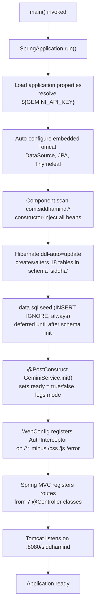

There is no explicit "background worker" or "scheduler initialization" phase because none exists in the code — this is stated explicitly rather than assumed, per the review's working rules.

## 6. Frontend Documentation

The frontend is **not a single-page application**. It is 23 Thymeleaf templates, each returned as a full HTML document by a controller method, sharing common fragments (`fragments/layout.html`: `head`, `navbar`, `sidebar`, `disclaimer`, `footer`, `scripts`). There is no component tree, no client-side state management, no hooks, and no client-side routing — "state" is entirely server-side (`HttpSession` + `Model` attributes rendered once per request). Verified by grepping all templates for `<script`, `fetch(`, `XMLHttpRequest`, `axios` — the only `<script>` tags are Bootstrap's bundle and a reference to a non-existent `/js/app.js` in the shared layout.

### 6.1 Page-by-page reference

| Template | Route(s) | Controller method | Model attributes (server "props") | Notes |
|---|---|---|---|---|
| `index.html` | `GET /` | `AuthController.home()` | none | Public landing page, demo-account table |
| `login.html` | `GET/POST /login` | `AuthController.loginWithParams()` / `login()` | `error`, `info`, `success` | Sets session on success, branches redirect by role |
| `register.html` | `GET/POST /register` | `AuthController.registerPage()` / `register()` | `error` | Self-service signup for any role (no email verification) |
| `denied.html` | `GET /denied` | `AuthController.denied()` | none | RBAC failure landing page |
| `dashboard/admin.html` | `GET /admin/dashboard` | `DashboardController.adminDash()` | `userCount`, `formulationCount`, `chunkCount`, `heavyMetalCount`, `aiReady`, `documents`, `logs`, role counts, `recentChecks`, `recentDiagnoses` | System-wide KPIs |
| `dashboard/practitioner.html` | `GET /practitioner/dashboard` | `DashboardController.practDash()` | `myDiagnoses`, `myChecks`, `formulationCount`, `chunkCount` | Scoped to `session.userId` |
| `dashboard/student.html` | `GET /student/dashboard` | `DashboardController.studentDash()` | `formulations`, counts, `myChats` | Study-oriented view |
| `dashboard/patient.html` | `GET /patient/dashboard` | `DashboardController.patientDash()` | `heavyMetalIngredients` | Public-safety-focused, no personal history shown |
| `profile.html` | `GET /profile` | `DashboardController.profile()` | `notifications` | |
| `assistant/chat.html` | `GET /assistant`, `GET /assistant/chat/{chatId}`, `POST /assistant/ask` | `AssistantController` | `aiReady`, `history`, `samples`, `messages`/`answer`, `chatId` | RAG chat UI, see §7.3 |
| `diagnosis/form.html` | `GET /diagnosis` | `DiagnosisController.form()` | `options` (8 Envagai Thervu factors → dropdown choices) | Practitioner/Admin only |
| `diagnosis/result.html` | `POST /diagnosis/assess` | `DiagnosisController.assess()` | `result` (`DiagnosisResult`), `patient` | Renders scores + candidate diseases + suggested formulations |
| `diagnosis/history.html` | `GET /diagnosis/history` | `DiagnosisController.history()` | `sessions` | Scoped to `session.userId` as practitioner |
| `formulary/list.html` | `GET /formulary?q=` | `FormularyController.list()` | `formulations`, `total`, `query` | Search by name (English or Tamil substring) |
| `formulary/detail.html` | `GET /formulary/{id}` | `FormularyController.detail()` | `formulation`, `ingredients` (Map entries), `indications`, `contraindications` | |
| `formulary/ingredients.html` | `GET /formulary/ingredients` | `FormularyController.ingredients()` | `ingredients` | |
| `formulary/diseases.html` | `GET /formulary/diseases` | `FormularyController.diseases()` | `diseases` | |
| `formulary/disease.html` | `GET /formulary/disease/{id}` | `FormularyController.disease()` | `disease`, `formulations` | |
| `safety/check.html` | `GET /safety`, `POST /safety/check` | `SafetyController` | `formulations`, `conditions`, `history`, `report` (`SafetyReport`) | Not visible to `PATIENT` role (interceptor-blocked) |
| `admin/users.html` | `GET /admin/users`, `POST /admin/users/create`, `/{id}/status`, `/{id}/reset` | `AdminController` | `users`, `roles`, `roleNames`, `error`/`success` | |
| `admin/corpus.html` | `GET /admin/corpus`, `POST /admin/corpus/upload`, `/{id}/index`, `/{id}/delete` | `AdminController` | `documents`, `chunkCount`, `aiReady` | |
| `admin/reports.html` | `GET /admin/reports` | `AdminController.reports()` | formulation/ingredient/disease/heavy-metal counts, role counts, `logs` | |

### 6.2 "Component hierarchy" (fragment reuse, since there is no JS component tree)

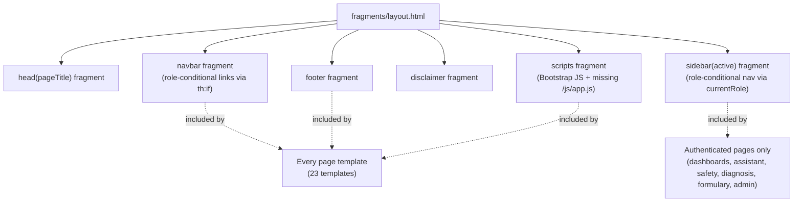

### 6.3 Data flow through the frontend

Because there is no client-side state, "data flow" is simply: **Controller populates `Model` → Thymeleaf interpolates it into HTML → browser renders a static page → user submits the next form → new full-page request.** Session-scoped values (`currentUser`, `currentRole`) are pushed onto every `ModelAndView` by `AuthInterceptor.postHandle()`, which is why every template can reference `${currentUser}`/`${currentRole}` in the shared navbar/sidebar without each controller having to add them individually.

Loading states and error states are conventional server-rendered patterns: `error`/`success`/`info` model attributes rendered as Bootstrap alert `div`s (see `login.html`), and there is **no client-side spinner or async loading indicator** — `data-busy`/`data-busy-text` attributes appear on some forms (e.g. `login.html`, `assistant/chat.html`) but the JavaScript that would act on them (`app.js`) does not exist in the repository, so these attributes are currently inert.

## 7. Backend Documentation

### 7.1 Controllers (7 classes, `controller/`)

| Controller | Base path | Injects | Responsibility |
|---|---|---|---|
| `AuthController` | `/`, `/login`, `/register`, `/logout`, `/denied` | `AuthService`, `ActivityLogRepository` | Session lifecycle, role-based post-login redirect, login audit logging |
| `DashboardController` | `/admin\|practitioner\|student\|patient/dashboard`, `/profile` | 11 repositories + `GeminiService` (no service layer — reads repositories directly) | Read-only aggregate views per role |
| `AdminController` | `/admin/**` | 9 repositories + `GeminiService` | User CRUD-lite (create/enable-disable/reset-password), corpus upload, **PDF indexing pipeline**, system reports |
| `AssistantController` | `/assistant/**` | `GeminiService`, `DocChunkRepository`, `SourceDocumentRepository`, `ChatSessionRepository`, `ChatMessageRepository` | Chat session management + inline RAG retrieval (logic lives in the controller, not a service — see §7.3) |
| `DiagnosisController` | `/diagnosis/**` | `DiagnosisService`, `DiagnosisSessionRepository` | Envagai Thervu form intake, hands scoring off to the service |
| `FormularyController` | `/formulary/**` | 6 repositories, no service | Pure read/browse of formulations, ingredients, diseases |
| `SafetyController` | `/safety/**` | `SafetyService`, 3 repositories | Drug-safety check intake, persists `SafetyCheck` audit row |

**Note on layering:** `AdminController`, `DashboardController`, and `FormularyController` talk directly to repositories with no intervening service class. Only `AssistantController`'s retrieval logic, `AuthService`, `DiagnosisService`, and `SafetyService` represent a true service layer. This is a real inconsistency (see §21) — not a deliberate architectural pattern.

### 7.2 Services (`service/`)

- **`AuthService`** — `authenticate(email, password)` looks up by email, checks `status=="ACTIVE"` and SHA-256(password) equality, updates `last_login`. `register()` rejects duplicate emails, defaults role lookup logic is dead code in practice since `roleName` is always supplied by the registration form. `getRoleName(roleId)` is a simple repository lookup used to populate the session `role` attribute.
- **`DiagnosisService`** — Contains a **static, in-memory scoring table** (`SCORING`, a `Map<String, Map<String,int[]>>`) mapping each of the 8 Envagai Thervu examination factors (naadi/pulse, naa/tongue, niram/complexion, mozhi/voice, vizhi/eyes, sparisam/touch, malam/stool, moothiram/urine) to a `[vatham, pitham, kabam]` integer weight triple. `assess()` sums the weights the practitioner selected, declares the dominant kutram by simple `>=` comparison, looks up `Disease` rows by `mukkutramType` (plus always including `MIXED`-type diseases), collects formulations indicated for those diseases via `formulation_diseases`, and — if Gemini is configured — asks it for a 3–4 sentence clinical reasoning note appended as `aiSummary`. This entire scoring table is **hardcoded Java, not database-driven** — extending it means editing `DiagnosisService.java`, not adding rows to a table.
- **`SafetyService`** — see the deep-dive in §10.2/§13; deterministic rule engine, AI only phrases the explanation.
- **`GeminiService`** — thin wrapper: `isReady()` exposes the feature flag set at startup; `generate(prompt)` builds a JSON body by string concatenation, POSTs to `{baseUrl}/{chatModel}:generateContent?key={apiKey}`, and extracts the response text by scanning for the literal substring `"text"` in the raw JSON response and taking the next quoted string — **not** a JSON parser, so it is fragile to any response-shape change or escaped-quote edge case in the model's answer. On any exception it prints a stack trace and returns `null`, which every caller treats as "AI unavailable, fall back to offline mode."

### 7.3 The "RAG pipeline" as it actually exists (important — contradicts the README)

`AssistantController.ask()` implements the entire retrieval step itself:

1. `chunkRepo.findAll()` — loads **every row of `doc_chunks` into memory** on every question (no pagination, no index, no vector search).
2. Lower-cases the question, splits on whitespace into keywords.
3. Linearly scans all chunks; a chunk "matches" if any keyword longer than 2 characters is a case-insensitive substring of the chunk's content.
4. Stops after 6 matches (hardcoded, not `app.rag.top-k`), and assigns each a fake similarity score string of `(85 + found) + "%"` — **this is not a real similarity score**, it is match order dressed up as a percentage.
5. If Gemini is ready and at least one chunk matched, builds a prompt instructing the model to answer only from the numbered passages, and calls `GeminiService.generate()`.
6. If no key is configured, falls back to displaying the retrieved passages without a generated answer ("offline retrieval mode").

**What the README describes but the code does not implement:** embedding the question via `text-embedding-004` or the "deterministic 256-d local fallback," cosine-similarity ranking, the `app.rag.top-k=6`/`app.rag.min-score=0.55` config keys being read anywhere, and any OCR fallback via Tesseract for scanned pages (`AdminController.indexDoc()` simply `continue`s past any page whose PDFBox-extracted text is blank — Tess4J is never invoked despite being a Maven dependency). The `doc_chunks.embedding` column exists in the entity (`DocChunk.embedding`) but is **never written or read** anywhere in the codebase. If you are asked to "finish" the RAG pipeline, this is the gap to close — the design intent is clear from the README and the unused column/config keys, but the implementation is keyword search only.

### 7.4 Utilities

- **`HashUtil.sha256(String)`** — `MessageDigest`-based SHA-256 hex digest, no salt, no iteration count (not bcrypt/PBKDF2/Argon2). See §16.
- **`TextUtil.chunk(text, size, overlap)`** — pure sliding-window substring chunker; used only by `AdminController.indexDoc()` with hardcoded `900, 150` rather than the `app.rag.chunk-size`/`app.rag.chunk-overlap` properties.

### 7.5 DTOs vs Entities

Entities (`entity/*.java`) are 1:1 JPA-mapped to tables and used directly as Thymeleaf model objects in many views (e.g., `Formulation`, `Ingredient`, `Disease` are passed straight to templates — there is no separate "view model" for these). DTOs (`dto/*.java`) are used only where the shape genuinely differs from a table row: `Citation`/`RagAnswer` (assistant response shaping), `Finding`/`SafetyReport` (safety check output), `DiagnosisResult` (diagnosis output combining scores + candidate lists). None of the DTOs or entities carry Bean Validation annotations despite `spring-boot-starter-validation` being a dependency.

## 8. API / Route Reference

There is no JSON REST API — every route below returns server-rendered HTML (or a redirect). "Request/Response" here means the HTML form fields consumed and the view rendered.

| Method | Route | Controller.method | Auth (via `AuthInterceptor`) | Key params | Renders / redirects |
|---|---|---|---|---|---|
| GET | `/` | `AuthController.home` | Public | — | `index.html` |
| GET | `/login` | `AuthController.loginWithParams` | Public | `info`, `success` (query) | `login.html` |
| POST | `/login` | `AuthController.login` | Public | `email`, `password` | redirect to role dashboard, or re-render `login.html` with `error` |
| GET | `/logout` | `AuthController.logout` | Any session | — | invalidates session → redirect `/login` |
| GET | `/register` | `AuthController.registerPage` | Public | — | `register.html` |
| POST | `/register` | `AuthController.register` | Public | `fullName`, `email`, `password`, `phone`, `roleName`, `regNumber`, `institution` | redirect `/login`, or re-render with `error` |
| GET | `/denied` | `AuthController.denied` | Public | — | `denied.html` |
| GET | `/admin/dashboard` | `DashboardController.adminDash` | `ADMIN` only | — | `dashboard/admin.html` |
| GET | `/practitioner/dashboard` | `DashboardController.practDash` | authenticated | — | `dashboard/practitioner.html` |
| GET | `/student/dashboard` | `DashboardController.studentDash` | authenticated | — | `dashboard/student.html` |
| GET | `/patient/dashboard` | `DashboardController.patientDash` | authenticated | — | `dashboard/patient.html` |
| GET | `/profile` | `DashboardController.profile` | authenticated | — | `profile.html` |
| GET | `/admin/users` | `AdminController.users` | `ADMIN` only | — | `admin/users.html` |
| POST | `/admin/users/create` | `AdminController.createUser` | `ADMIN` only | `fullName`, `email`, `password`, `roleName`, `phone?`, `regNumber?`, `institution?` | `admin/users.html` |
| POST | `/admin/users/{id}/status` | `AdminController.toggleStatus` | `ADMIN` only | `status` | redirect `/admin/users` |
| POST | `/admin/users/{id}/reset` | `AdminController.resetPassword` | `ADMIN` only | `newPassword` | redirect `/admin/users` |
| GET | `/admin/corpus` | `AdminController.corpus` | `ADMIN` only | — | `admin/corpus.html` |
| POST | `/admin/corpus/upload` | `AdminController.upload` | `ADMIN` only | `file` (multipart), `title?`, `author?`, `bookCode?`, `language?` | `admin/corpus.html` |
| POST | `/admin/corpus/{id}/index` | `AdminController.indexDoc` | `ADMIN` only | — | PDFBox extraction + `TextUtil.chunk` → `doc_chunks` rows; `admin/corpus.html` |
| POST | `/admin/corpus/{id}/delete` | `AdminController.deleteDoc` | `ADMIN` only | — | deletes chunks then the document; redirect `/admin/corpus` |
| GET | `/admin/reports` | `AdminController.reports` | `ADMIN` only | — | `admin/reports.html` |
| GET | `/assistant` | `AssistantController.chat` | authenticated | — | `assistant/chat.html` |
| GET | `/assistant/chat/{chatId}` | `AssistantController.chatHistory` | authenticated | — | `assistant/chat.html` with prior messages |
| POST | `/assistant/ask` | `AssistantController.ask` | authenticated | `question`, `chatId?` | keyword retrieval + optional Gemini call → `assistant/chat.html` |
| GET | `/diagnosis` | `DiagnosisController.form` | `PRACTITIONER` or `ADMIN` | — | `diagnosis/form.html` |
| POST | `/diagnosis/assess` | `DiagnosisController.assess` | `PRACTITIONER` or `ADMIN` | `patientName`, `age?`, `gender?`, `complaint?`, `naadi`, `naa`, `niram`, `mozhi`, `vizhi`, `sparisam`, `malam`, `moothiram` | `diagnosis/result.html` |
| GET | `/diagnosis/history` | `DiagnosisController.history` | `PRACTITIONER` or `ADMIN` | — | `diagnosis/history.html` |
| GET | `/formulary` | `FormularyController.list` | authenticated | `q?` | `formulary/list.html` |
| GET | `/formulary/{id}` | `FormularyController.detail` | authenticated | — | `formulary/detail.html` |
| GET | `/formulary/ingredients` | `FormularyController.ingredients` | authenticated | — | `formulary/ingredients.html` |
| GET | `/formulary/diseases` | `FormularyController.diseases` | authenticated | — | `formulary/diseases.html` |
| GET | `/formulary/disease/{id}` | `FormularyController.disease` | authenticated | — | `formulary/disease.html` |
| GET | `/safety` | `SafetyController.page` | authenticated, **not** `PATIENT` | — | `safety/check.html` |
| POST | `/safety/check` | `SafetyController.check` | authenticated, **not** `PATIENT` | `formId`, `drugs?`, `conditions?` | `safety/check.html` with `report` |

No route returns a non-2xx status code deliberately in application logic — errors are handled by re-rendering the same template with an `error` model attribute, or by Spring Boot's default `/error` handling for unhandled exceptions (e.g., a malformed PDF during indexing is caught inside `AdminController.indexDoc()`'s own `try/catch` and surfaced as `error`, not a 500).

### 8.1 Sequence diagram — safety check (representative of the "form POST → rule engine → optional AI phrasing" pattern used across the app)

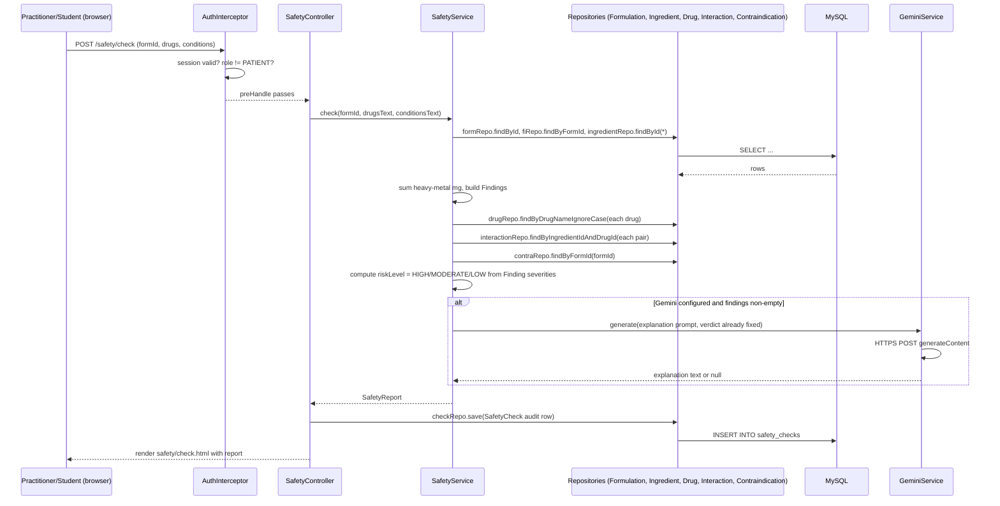

## 9. Database Documentation

**Engine:** MySQL 8, schema `siddha`, auto-created (`createDatabaseIfNotExist=true`). **Schema source of truth:** Hibernate `ddl-auto=update`, driven by the 18 `@Entity` classes — there is no hand-written DDL file in the repo (the README's `db/schema-reference.sql` does not exist here).

**Important structural fact:** none of the entities declare JPA relationships (`@ManyToOne`, `@OneToMany`, `@JoinColumn`). Every "foreign key" (e.g., `User.roleId`, `Formulation` ↔ `Ingredient` via `FormulationIngredient.formId`/`ingredientId`) is a **plain `Long` column**. Hibernate therefore creates **no actual foreign-key constraints in MySQL** — referential integrity is enforced only by application code that happens to look up the right ID. This has two consequences worth flagging to any engineer: (1) it is possible to insert orphaned rows directly via SQL or a future admin feature without the database objecting, and (2) every "join" in the app (e.g., `FormularyController.detail()`) is a manual loop of `repository.findById()` calls rather than a JPA-managed object graph — see §17 for the N+1 performance implication.

### 9.1 Table inventory

| Table | Entity | Purpose | Notable columns |
|---|---|---|---|
| `roles` | `Role` | 4 fixed roles | `role_name` unique |
| `users` | `User` | All accounts, all roles | `email` unique, `password_hash` (SHA-256 hex, 64 chars), `role_id`, `status` |
| `source_documents` | `SourceDocument` | Uploaded corpus PDFs | `file_path`, `indexed`, `chunk_count`, `uploaded_by` |
| `doc_chunks` | `DocChunk` | Indexed text passages | `doc_id`, `page_no`, `chunk_index`, `content`, `embedding` (unused, always NULL) |
| `ingredients` | `Ingredient` | Siddha materia medica items | `heavy_metal`, `element_symbol`, `toxicity_class`, `max_daily_mg` |
| `formulations` | `Formulation` | Classical preparations | `contains_heavy_metal`, `safety_class` (GREEN/AMBER/RED), `source_book`, `page_no`, `verse_no` |
| `formulation_ingredients` | `FormulationIngredient` | Formulation ↔ ingredient join with quantity/sutthi note | `form_id`, `ingredient_id` |
| `diseases` | `Disease` | Classical "noi" mapped to modern equivalents | `mukkutram_type` (VATHAM/PITHAM/KABAM/MIXED) |
| `formulation_diseases` | `FormulationDisease` | Formulation ↔ disease indication join | `form_id`, `disease_id`, `evidence_note` |
| `allopathic_drugs` | `AllopathicDrug` | Modern drugs for interaction checking | `drug_name`, `drug_class` |
| `interactions` | `Interaction` | Ingredient × drug interaction facts | `ingredient_id`, `drug_id`, `severity`, `mechanism`, `advice` |
| `contraindications` | `Contraindication` | Formulation × condition contraindication facts | `form_id`, `condition_name`, `severity` |
| `diagnosis_sessions` | `DiagnosisSession` | Envagai Thervu records | 8 examination fields + 3 scores + `dominant_kutram`, `ai_summary` |
| `safety_checks` | `SafetyCheck` | Safety-check audit trail | `user_id`, `form_id`, `drugs_entered`, `conditions_entered`, `risk_level` |
| `chat_sessions` | `ChatSession` | Assistant conversation threads | `user_id`, `title` |
| `chat_messages` | `ChatMessage` | Individual chat turns | `chat_id`, `sender` (USER/AI), `citations` (flattened string, not normalized) |
| `activity_logs` | `ActivityLog` | Login audit trail (only LOGIN events are logged in current code) | `user_id`, `action`, `ip_address` |
| `notifications` | `Notification` | Per-user notices, seeded only, no code path creates new ones at runtime | `user_id`, `is_read` |

### 9.2 ER diagram

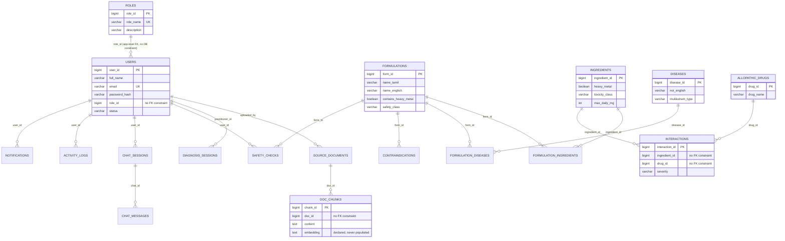

### 9.3 CRUD mapping (by table)

| Table | Create | Read | Update | Delete |
|---|---|---|---|---|
| `users` | `AdminController.createUser`, `AuthController.register` | `AdminController.users`, `AuthService.authenticate` | `AdminController.toggleStatus`, `resetPassword`, `AuthService.authenticate` (last_login) | none (no delete path) |
| `source_documents` | `AdminController.upload` | `AdminController.corpus`, `DashboardController.adminDash` | `AdminController.indexDoc` (sets indexed/chunk_count/total_pages) | `AdminController.deleteDoc` |
| `doc_chunks` | `AdminController.indexDoc` | `AssistantController.ask` (full scan) | none | `AdminController.deleteDoc` (cascade by `chunkRepo.deleteByDocId`) |
| `formulations`, `ingredients`, `diseases`, `allopathic_drugs`, `interactions`, `contraindications`, `formulation_ingredients`, `formulation_diseases` | seed data only (`data.sql`) | `FormularyController`, `SafetyService`, `DiagnosisService` | none | none |
| `diagnosis_sessions` | `DiagnosisService.assess` | `DiagnosisController.history`, dashboards | none | none |
| `safety_checks` | `SafetyController.check` | `SafetyController.page`, dashboards | none | none |
| `chat_sessions` / `chat_messages` | `AssistantController.ask` | `AssistantController.chat`/`chatHistory` | none | none |
| `activity_logs` | `AuthController.login` only | `AdminController.reports`, `DashboardController.adminDash` | none | none |
| `notifications` | seed data only | `DashboardController.profile` | none | none |

There is **no update/delete UI for the knowledge base** (formulations, ingredients, diseases, drugs, interactions) — it is entirely seed-data-driven. Extending the formulary means either editing `data.sql` or adding new admin CRUD screens (currently absent).

## 10. Authentication & Authorization

There is no Spring Security, no JWT, no OAuth, no refresh tokens anywhere in this codebase. Everything is a **hand-rolled `HttpSession`-based mechanism**.

### 10.1 Login lifecycle

1. `POST /login` with `email`+`password` → `AuthController.login()`.
2. `AuthService.authenticate()`: find `User` by email, require `status == "ACTIVE"`, compare `HashUtil.sha256(password)` to the stored `password_hash` (constant-time comparison is **not** used — plain `String.equals`).
3. On success: `req.getSession(true)` creates a session; `userId`, `currentUser` (the whole `User` entity, including the password hash field, is stored in the session object graph), and `role` (resolved via `AuthService.getRoleName`) are set as session attributes.
4. An `ActivityLog` row (`action=LOGIN`) is written with the client's `req.getRemoteAddr()`.
5. Redirect target is chosen by a `switch` on role name: `ADMIN→/admin/dashboard`, `PRACTITIONER→/practitioner/dashboard`, `STUDENT→/student/dashboard`, else (`PATIENT`)`→/patient/dashboard`.

### 10.2 Logout

`GET /logout` calls `session.invalidate()` and redirects to `/login?info=Signed+out.` — a simple, complete session teardown (no token blacklist needed since there are no tokens).

### 10.3 Registration

`POST /register` (public) lets anyone self-register as **any role**, including `PRACTITIONER` or `ADMIN` if they type that `roleName` — there is no server-side restriction on which roles the public registration form may create (the actual HTML form in `register.html` presumably limits the `<select>` options, but the controller itself does not re-validate that only STUDENT/PATIENT self-registration is allowed). This is a notable authorization gap — see §16.

### 10.4 Session-based RBAC (`AuthInterceptor`)

`config/AuthInterceptor.java` is the **only** access-control component. Logic:

- `PUBLIC` path prefixes (`/`, `/login`, `/register`, `/logout`, `/css/`, `/js/`, `/error`) bypass all checks.
- Otherwise: no session or no `userId` attribute → redirect `/login`.
- Path-prefix role rules, evaluated in order:
  - `/admin/**` requires `role == "ADMIN"`, else redirect `/denied`.
  - `/diagnosis/**` requires `role == "PRACTITIONER"` or `"ADMIN"`, else redirect `/denied`.
  - `/safety/**` blocks `role == "PATIENT"` specifically (everyone else, including STUDENT, is allowed), else redirect `/denied`.
  - All other authenticated routes (dashboards by role, `/formulary/**`, `/assistant/**`, `/profile`) have no further role restriction beyond "logged in" — note the per-role dashboard controller methods themselves do **not** re-check that the caller's session role matches the dashboard they're requesting (e.g., a PATIENT session hitting `/admin/dashboard` is stopped by the interceptor, but a PRACTITIONER hitting `/student/dashboard` is not blocked by anything — cross-role dashboard viewing between non-admin roles is possible).
- `postHandle()` pushes `currentUser`/`currentRole` onto every `ModelAndView` so templates can branch on them.

There is no method-level (`@PreAuthorize`) security and no CSRF protection (Spring Security's CSRF filter is absent since Spring Security itself is absent) — every state-changing endpoint is a plain form POST with no anti-CSRF token.

### 10.5 Authentication/authorization sequence diagram

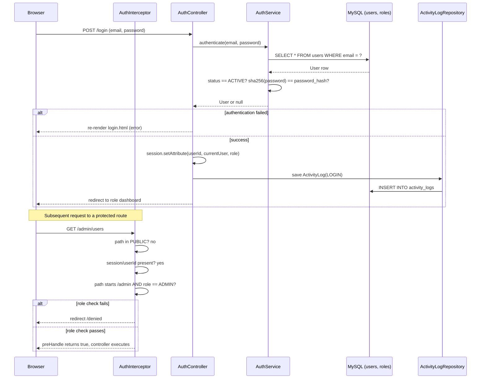

## 11. Business Workflows

### 11.1 Drug Safety Checker (deterministic rule engine — `SafetyService.check`)

**Inputs:** `formId` (which classical preparation), free-text comma-separated `drugs`, free-text comma-separated `conditions`.
**Rules, in order:**
1. **Heavy-metal screen** — for every ingredient in the formulation flagged `heavy_metal=true` with a non-null `max_daily_mg`, add its mg to a running total and emit a `Finding` (`MAJOR` if `toxicity_class=="HIGH"`, else `MODERATE`).
2. **Drug interaction match** — for each entered drug name, look it up case-insensitively in `allopathic_drugs`; for every ingredient in the formulation, look up `interactions` rows for that ingredient×drug pair and emit a `Finding` per row found. Unmatched drug names are collected separately (`unmatchedDrugs`) and shown to the user rather than silently ignored.
3. **Contraindication match** — for each entered condition (free text), substring-match (case-insensitive) against `contraindications.condition_name` for the formulation and emit a `Finding` per match. This is a loose substring match, not an exact/controlled-vocabulary match, so typos or partial words can both under- and over-match.
4. **Risk verdict** — `riskLevel = HIGH` if any `MAJOR` finding exists, else `MODERATE` if any `MODERATE` finding exists, else `LOW`. **This computation never calls the AI.**
5. **AI explanation (optional, last step)** — only if Gemini is configured and there is at least one finding, a prompt is built that states the already-computed verdict and findings, explicitly instructing the model: *"Do NOT change the verdict or add new interactions."* The model's output is purely explanatory prose, stored as `aiExplanation`, never re-parsed for information.
6. Every check is persisted to `safety_checks` regardless of AI availability, giving a complete audit trail independent of the AI's uptime.

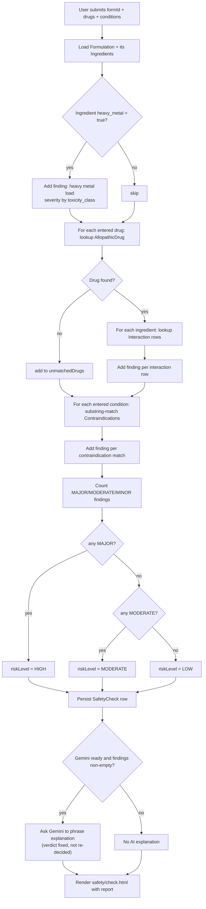

### 11.2 Envagai Thervu diagnosis (`DiagnosisService.assess`)

**Inputs:** 8 categorical examination findings selected from fixed dropdown option sets (`getOptions()` derived from the static `SCORING` table) plus free-text patient demographics/complaint.
**Rule:** each selected option contributes a hardcoded `[vatham, pitham, kabam]` weight; totals determine the dominant kutram (ties broken toward vatham, then pitham, by the `>=` comparison order). Candidate diseases are looked up by `mukkutramType` matching the dominant kutram plus any `MIXED`-type diseases; formulations are looked up transitively via `formulation_diseases` for those candidate diseases. An AI clinical-reasoning note is optionally appended. The session (inputs + scores + AI note) is persisted to `diagnosis_sessions` regardless of AI availability.

### 11.3 Corpus indexing (`AdminController.indexDoc`)

**Inputs:** an already-uploaded `SourceDocument` row (file already on disk in `./corpus`).
**Steps:** open with PDFBox, iterate pages 1..N, extract text per page with `PDFTextStripper`, skip blank pages (no OCR fallback despite Tess4J being a dependency), chunk each page's text with a 900-char/150-overlap sliding window, persist one `DocChunk` row per chunk (with `page_no` and `chunk_index` preserved for citation), then mark the `SourceDocument` `indexed=true` with the final `chunk_count`. This runs **synchronously on the HTTP request thread** — large PDFs (the seed data references a 932-page textbook) will produce a long-held request and a large number of individual `chunkRepo.save()` calls (one per chunk, not batched).

### 11.4 SiddhaMind Assistant chat turn

See §7.3 for the retrieval mechanics. Business-level flow: create-or-continue a `ChatSession`, persist the user's message, run keyword retrieval over `doc_chunks`, optionally call Gemini with a citation-constrained prompt, persist the AI (or fallback) message with a flattened citation string, and re-render the chat view with both the new turn and full session history in the sidebar.

## 12. Complete Request Lifecycle (representative: asking the Assistant a question)

```
User types a question, clicks "Ask"
   ↓ Browser: HTML <form method="post" action="/assistant/ask">
   ↓ HTTP POST /siddhamind/assistant/ask  (form-encoded: question, chatId)
   ↓ Servlet container (Tomcat) → Spring DispatcherServlet
   ↓ AuthInterceptor.preHandle — session/userId check (path not in PUBLIC, not /admin /diagnosis /safety, so only login is required)
   ↓ AssistantController.ask(question, chatId, session, model)
       ↓ ChatSessionRepository — create or fetch ChatSession
       ↓ ChatMessageRepository.save — persist the USER message
       ↓ DocChunkRepository.findAll() — full table scan
       ↓ in-memory keyword match loop → up to 6 Citations
       ↓ GeminiService.isReady() ? GeminiService.generate(prompt) : offline-mode message
           ↓ (if ready) java.net.http.HttpClient → HTTPS POST to Gemini
           ↓ manual JSON string parsing of the response
       ↓ ChatMessageRepository.save — persist the AI/fallback message
       ↓ Model.addAttribute(answer, chatId, aiReady, history, samples)
   ↓ AuthInterceptor.postHandle — inject currentUser/currentRole into the ModelAndView
   ↓ Thymeleaf ViewResolver renders assistant/chat.html against the Model
   ↓ Full HTML response sent back to the browser
   ↓ Browser replaces the whole page (no client-side state update — this is a full navigation, not an SPA re-render)
```

### 12.1 Sequence diagram

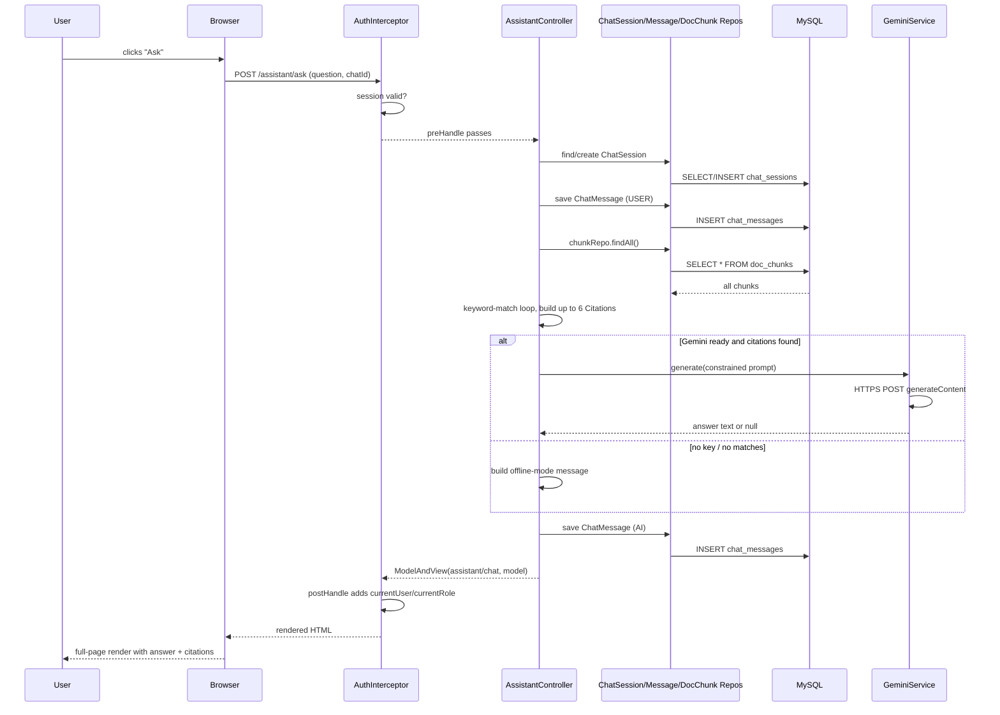

## 13. Function-Level Notes (selected, non-trivial functions)

| Function | File | Purpose | Params → Return | Side effects / DB / external calls |
|---|---|---|---|---|
| `SafetyService.check` | `service/SafetyService.java` | Deterministic safety verdict + optional AI phrasing | `(formId, drugsText, conditionsText) → SafetyReport` | Reads 5 repositories; calls `GeminiService.generate` conditionally; **no writes** (caller persists the audit row) |
| `DiagnosisService.assess` | `service/DiagnosisService.java` | Mukkutram scoring, candidate disease/formulation lookup, AI note | `(DiagnosisSession) → DiagnosisResult` | Reads `Disease`/`FormulationDisease`/`Formulation` repos; calls Gemini conditionally; **writes** `diagnosis_sessions` via `sessionRepo.save` |
| `AdminController.indexDoc` | `controller/AdminController.java` | PDF → text → chunks → `doc_chunks` rows | `(id, model) → view name` | Filesystem read (PDFBox), N `chunkRepo.save()` calls (unbatched), 1 `docRepo.save()` |
| `AssistantController.ask` | `controller/AssistantController.java` | Retrieval + optional generation + persistence | `(question, chatId, session, model) → view name` | Full-table `chunkRepo.findAll()`, 2 message saves, conditional Gemini HTTP call |
| `GeminiService.generate` | `service/GeminiService.java` | Blocking call to Gemini `generateContent` | `(prompt) → answer text or null` | Synchronous outbound HTTPS call on the request thread; no timeout configured on the `HttpClient` |
| `AuthInterceptor.preHandle` | `config/AuthInterceptor.java` | Central RBAC gate | `(request, response, handler) → boolean` | Redirects (side effect on `response`), no DB access itself (reads only session attributes) |
| `TextUtil.chunk` | `util/TextUtil.java` | Sliding-window text splitter | `(text, size, overlap) → List<String>` | Pure function, no side effects |
| `HashUtil.sha256` | `util/HashUtil.java` | Password digest | `(input) → hex string` | Pure function, no side effects |

Because there is no test suite, none of these functions have any automated verification today (see §22).

## 14. Module Dependencies

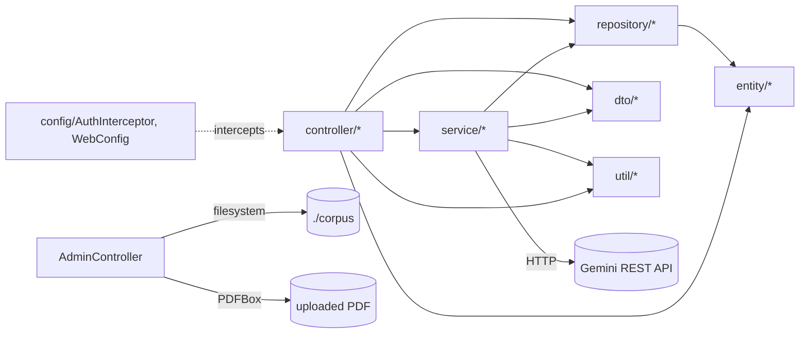

There is no circular dependency between layers; the one place layering is bent is that `AdminController`, `DashboardController`, and `FormularyController` depend directly on `repository/*` rather than going through a `service/*` intermediary (see §21, technical debt).

## 15. Data Flow Diagrams

### 15.1 Context diagram

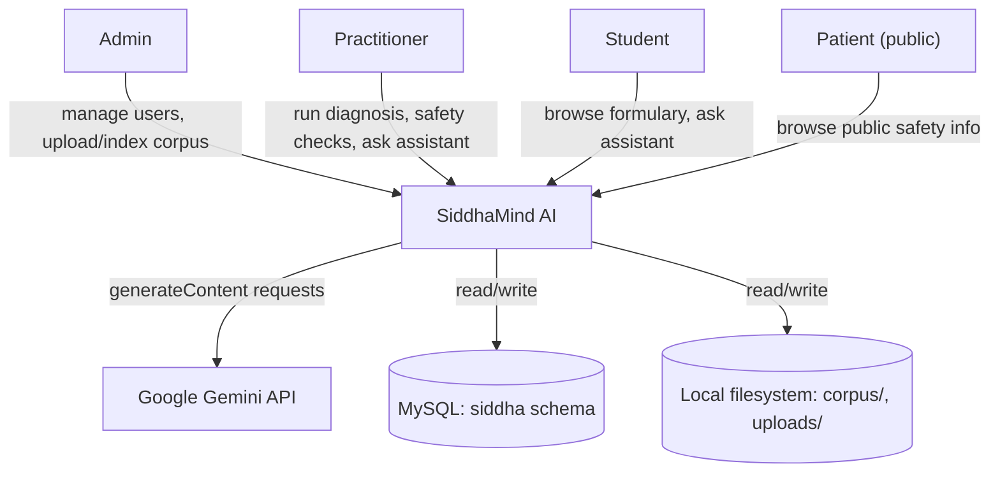

### 15.2 DFD Level 0

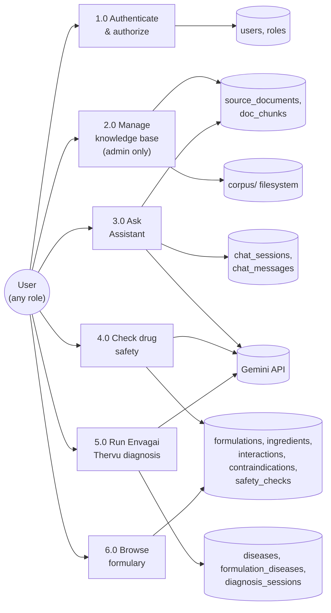

### 15.3 DFD Level 1 — "3.0 Ask Assistant" expanded

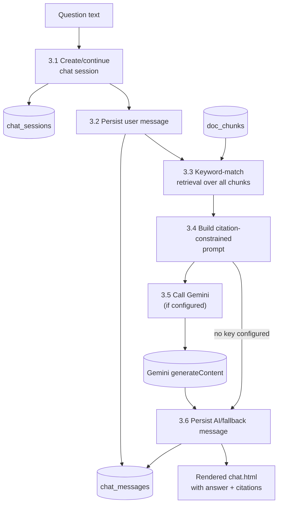

## 16. Discrepancies Between README and Actual Code (explicit, not guessed)

This section exists because the review's working rule is to state what cannot be verified rather than assume. Everything below was confirmed by grep/read across the entire `src/` tree.

1. **No RAG embeddings.** README: "embed (Gemini text-embedding-004 \| local 256-d fallback) → cosine similarity." Code: `AssistantController.ask()` does a linear keyword substring scan over `chunkRepo.findAll()`. `DocChunk.embedding` exists as a column/field but is never written or read anywhere.
2. **No OCR fallback.** README: "pages with no text layer are rendered at 300 dpi and passed to Tesseract." Code: `AdminController.indexDoc()` simply `continue`s past blank-text pages. Tess4J (`net.sourceforge.tess4j:tess4j:5.9.0`) is a Maven dependency with zero references anywhere in `src/main/java`.
3. **`app.rag.*` and `app.ocr.*` properties are unused.** `chunk-size`, `chunk-overlap`, `top-k`, `min-score`, `datapath`, `languages` are all defined in `application.properties` but never read via `@Value` anywhere in the codebase (confirmed by grep). The real chunk size/overlap (900/150) is hardcoded in `AdminController.indexDoc()`.
4. **Missing static assets.** `fragments/layout.html` references `/css/siddha.css` and `/js/app.js`; neither file exists anywhere in the repository (`static/` contains only an empty `static/js/` directory). At runtime this means the app has **no custom styling or JS behavior** beyond Bootstrap's CDN defaults — `data-busy`/`data-busy-text` form attributes used in several templates are inert.
5. **No `db/schema-reference.sql`.** Referenced twice in the README as documentation; not present in this checkout. Hibernate `ddl-auto=update` is the only schema source.
6. **Controller count.** README's structure diagram says "8 controllers"; there are 7 files in `controller/`.
7. **Jackson declared, unused for its stated purpose.** `jackson-databind` is a dependency "for JSON handling for the Gemini REST API," but `GeminiService` builds and parses JSON by hand with string concatenation and `indexOf`/`substring`, not Jackson's `ObjectMapper`.

## 17. Security Review

| Area | Finding |
|---|---|
| Authentication | Custom session-based, no MFA, no account lockout after repeated failures, no rate limiting on `/login`. |
| Password storage | SHA-256, **unsalted, no key-stretching** (`HashUtil.sha256`). This is fast to brute-force at scale compared to bcrypt/Argon2/PBKDF2. The demo seed passwords (`admin123` etc.) are published in `README.md` and `data.sql` comments — acceptable for a demo, dangerous if this schema/seed ever reaches a real deployment unchanged. |
| Session fixation | `req.getSession(true)` is called on login without first invalidating any pre-existing session — a classic session-fixation vector if an attacker can plant a session ID before login (mitigated somewhat by Tomcat's default session-ID regeneration behavior, but not addressed in application code). |
| Authorization | Role checks are path-prefix string comparisons in `AuthInterceptor`, not a declarative/annotated policy — easy to silently miss when adding a new route (e.g., a hypothetical `/admin2/...` route would bypass the `/admin` check entirely). Registration (`POST /register`) does not restrict which `roleName` values the public can submit at the controller level. Cross-dashboard viewing between non-admin roles is not blocked (see §10.4). |
| CSRF | No CSRF tokens anywhere (Spring Security's CSRF filter is absent). Every state-changing action (`POST /admin/users/create`, `/safety/check`, etc.) is vulnerable to cross-site form submission from an authenticated victim's browser. |
| XSS | Thymeleaf's `th:text` escapes output by default everywhere observed (no `th:utext` usage found in the templates read), which mitigates reflected/stored XSS from user-entered fields like `patientName` or chat questions. AI-generated text is also rendered through standard `th:text` bindings in `assistant/chat.html`. |
| SQL injection | All data access goes through Spring Data JPA derived queries (`findByEmail`, `findByDrugNameIgnoreCase`, etc.) — no raw/native `@Query` string concatenation was found, so this surface looks sound. |
| Secrets management | `app.gemini.api-key` defaults to the placeholder string and can be supplied via `GEMINI_API_KEY` env var — good practice. However, `application.properties` in this checkout has the **MySQL password hardcoded in plaintext** (`spring.datasource.password=Sakthivel@2006`) committed directly in the config file, not externalized. |
| Transport | No `server.ssl.*` configuration — the app runs plain HTTP on `:8080` by default; TLS termination, if any, would have to be external (not configured here). |
| File upload | `AdminController.upload` accepts any `MultipartFile` and writes it to `./corpus/{originalFilename}` with no filename sanitization, no content-type/extension allowlist, and no size check beyond the global `spring.servlet.multipart.max-file-size=50MB`. A crafted filename (e.g., containing `../`) is not defended against in code — path traversal risk depends entirely on `Path.resolve()`'s behavior, which was not further hardened. |
| Rate limiting | None, anywhere — including on the outbound Gemini calls (no backoff/retry/circuit breaker either). |
| Logging of sensitive data | The full `User` entity (including `passwordHash`) is stored as a session attribute (`currentUser`) and pushed into every `Model` for template rendering; the hash is not deliberately displayed by any template read, but it is present in the object graph passed to the view layer, which is unnecessary exposure. |
| Security headers | No CSP, HSTS, X-Frame-Options, or similar headers are configured (no `spring-boot-starter-security`, no manual filter). |

## 18. Performance Review

- **`AssistantController.ask()` loads the entire `doc_chunks` table into memory on every single question** (`chunkRepo.findAll()`), then does an O(chunks × keywords) substring scan in Java. This will degrade linearly with corpus size and does not use any database-side indexing or full-text search feature.
- **N+1 query patterns**: `FormularyController.detail()` loops over `FormulationIngredient` rows and calls `ingredientRepo.findById()` once per row inside the loop, instead of a single batched `findAllById()`. The same pattern repeats for diseases/indications in the same method, and for candidate formulations in `DiagnosisService.assess()`.
- **Unbatched inserts**: `AdminController.indexDoc()` calls `chunkRepo.save()` once per chunk inside a loop rather than `saveAll()` — for the largest seeded document (932 pages) this could be hundreds of individual round-trips.
- **Synchronous, unbounded external calls**: `GeminiService.generate()` uses `HttpClient.newHttpClient()` with no explicit connect/read timeout and no retry/backoff — a slow or hanging Gemini response will hold the Tomcat request-handling thread for the full duration, and there is no async/reactive boundary anywhere in the app to isolate this.
- **PDF indexing is synchronous** and runs entirely inside the HTTP request for `POST /admin/corpus/{id}/index` — no background job/queue, so an admin uploading a large PDF will simply have a very long-hanging request (bounded only by servlet/browser timeouts, both unconfigured here).
- **No caching layer** anywhere (no `@Cacheable`, no Redis/Ehcache) — repeatedly-read, rarely-changed data like the formulary and ingredient lists are re-queried from MySQL on every page view.
- **No pagination** on any listing endpoint (`admin/users`, `formulary/list`, `admin/corpus`, chat history) — all use `findAll()` and render the full result set.
- **No lazy-loading concerns from JPA relationships** because there are none declared (§9) — but this is a double-edged sword: it avoids Hibernate N+1 traps at the ORM level only by pushing the same N+1 pattern into hand-written service/controller code instead.

## 19. Code Quality Review

**Strengths:**
- The safety/diagnosis "rules decide, AI explains" separation (§10.2, §11.1–11.2) is a genuinely good design decision and is applied consistently in both `SafetyService` and `DiagnosisService`.
- Constructor injection is used consistently — no field injection, no static service locators.
- `GeminiService.isReady()` as a single feature flag consistently gates every AI-dependent code path, giving predictable "offline mode" behavior throughout the app.
- Naming is largely consistent and domain-appropriate (Tamil/Siddha terminology preserved deliberately, e.g. `naadi`, `mukkutramType`, `sutthiRequired`), which matters for a domain-specific academic tool.

**Weaknesses / technical debt:**
- **Inconsistent layering** — `AdminController`, `DashboardController`, `FormularyController` bypass the service layer and talk to repositories directly, while `AssistantController` embeds business logic (retrieval) that arguably belongs in a service, mirroring `SafetyService`/`DiagnosisService`'s pattern but not following it. A new engineer extending the assistant will not find an `AssistantService` to extend.
- **Dead/aspirational dependencies and config** — Tess4J, Jackson-for-Gemini, `spring-boot-starter-test`, `spring-boot-starter-validation`, and most of `app.rag.*`/`app.ocr.*` are present but unused (§16). This makes the `pom.xml` and `application.properties` misleading about what the app actually does.
- **No automated tests** — `spring-boot-starter-test` is declared but `src/test` does not exist. None of the business logic (safety rule engine, diagnosis scoring, RAG retrieval) has any regression protection.
- **`GeminiService`'s manual JSON handling** is fragile — any change in Gemini's response envelope, or an answer that itself contains the literal substring `"text"`, could break parsing silently (returns `null`, silently downgrading to offline mode rather than surfacing the real cause).
- **Entities doubling as view models** — passing JPA entities straight into Thymeleaf templates (e.g., `Formulation`, `Ingredient`) couples the persistence schema to the UI; a schema change immediately becomes a template-breaking change.
- **No `@Valid`/Bean Validation usage** despite the dependency being present — all input validation in controllers is implicit (`@RequestParam(required=false)` defaults) with no bounds/format checking, e.g., `age` is an unchecked `Integer`, `email` format is not validated server-side beyond the HTML5 `type="email"` input.
- **Read-only knowledge base with no admin CRUD** for formulations/ingredients/diseases/drugs/interactions — every extension to the domain data currently requires editing `data.sql` directly and restarting the app, which is a real maintenance bottleneck for a tool whose core value is its data.

## 20. Deployment

No Docker, no CI/CD, no infrastructure-as-code exist in this repository (confirmed: no `Dockerfile`, no `.github/`, no `*.yml`/`*.yaml` outside of what Maven itself might generate in `target/`). Deployment as documented in the README is manual:

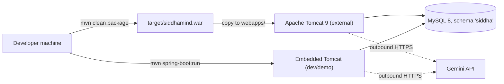

Both paths share the same `application.properties`, meaning environment-specific values (DB credentials, Gemini key) must be edited in place or overridden via `GEMINI_API_KEY` — there is no per-environment profile mechanism configured.

## 21. Scalability Assessment

The application is architected for a single-instance, single-database deployment and would need real work before scaling horizontally:

- **Session state is in-memory (`HttpSession`)** with no external session store configured — running multiple app instances behind a load balancer would require sticky sessions or a shared session store (e.g., Redis), neither of which is present.
- **The full-corpus keyword scan (§18)** will not scale past a small number of indexed PDFs; the README's own target design (embeddings + vector search) would be the natural fix, and the schema (`doc_chunks.embedding`) already anticipates it.
- **No connection pooling tuning** beyond Spring Boot/HikariCP defaults is visible in `application.properties`.
- **File storage on local disk** (`./corpus`, `./uploads`) does not scale across multiple app instances or survive container restarts without an external volume/object store.
- **Synchronous outbound AI calls on request threads** mean the app's request-handling capacity is directly coupled to Gemini's latency; under load this could exhaust the Tomcat thread pool.

## 22. Risks & Recommendations

| Risk | Recommendation |
|---|---|
| Hardcoded MySQL password in `application.properties` | Externalize via environment variable, matching the pattern already used for `GEMINI_API_KEY` |
| No CSRF protection on state-changing forms | Adopt Spring Security (even minimally, for CSRF + session management) rather than the hand-rolled interceptor |
| Unsalted SHA-256 passwords | Migrate to BCrypt/Argon2 via Spring Security's `PasswordEncoder` |
| Full-table scan RAG retrieval | Either implement the embeddings pipeline the schema/README already anticipate, or add a MySQL full-text index as a nearer-term improvement |
| No tests | Prioritize unit tests for `SafetyService` and `DiagnosisService` first — they are pure, deterministic, and highest business value to protect |
| Public registration allows any role | Restrict `AuthController.register()` to STUDENT/PATIENT server-side regardless of what the form submits |
| Synchronous PDF indexing | Move to an async job (even a simple `@Async` method) so large corpus uploads don't hold a request thread |
| No admin CRUD for domain data | This is the biggest practical limitation on the project's stated mission (expanding the knowledge base) — build it before adding new AI features |

## 23. Architecture Summary

SiddhaMind AI is a coherent, understandable Spring Boot + Thymeleaf monolith whose real strength is domain modeling (18 well-thought-out tables capturing Siddha formulations, ingredients, diseases, and their relationships to modern drugs) and one genuinely sound safety pattern (deterministic verdict, AI explains afterward — `SafetyService`, mirrored in `DiagnosisService`). Its principal gap is that the "AI-powered" and "RAG" framing in the README describes a more sophisticated retrieval pipeline (embeddings, cosine similarity, OCR) than what `AssistantController` and `AdminController` currently implement (keyword substring matching, PDFBox-only text extraction). A new engineer's fastest path to being productive is: read `SafetyService` and `DiagnosisService` first (the two real service-layer exemplars), then `AssistantController.ask()` (to understand the gap between documented and actual RAG), then `AuthInterceptor` (the entire security model in ~50 lines). Everything else in the codebase — the 7 controllers, 18 entities, 18 repositories — follows directly from those four files' patterns.

---

*Compiled by reading every file under `src/`, `pom.xml`, `README.md`, `.gitignore`, and `.vscode/settings.json` in this repository as of 2026-08-02. `target/` (Maven build output) was excluded as a generated artifact per the review's scope rules.*
